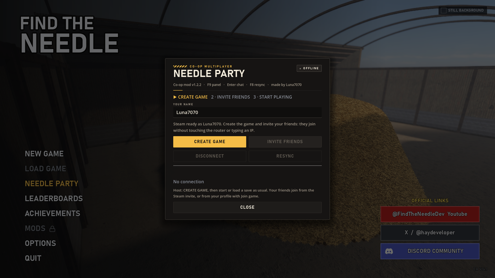

# NEEDLE PARTY — Find The Needle Multiplayer Mod

**Online co-op multiplayer mod for [Find The Needle](https://store.steampowered.com/app/5160800/Find_The_Needle/) (full game).**
Play with your friends over Steam: same haystack, same factory, shared money.

## Features

- Steam lobbies, invite friends in game — no port forwarding
- Everything shared and synced: pile, buildings, machines, money, tech, missions
- Smooth movement, low ping, no stutters
- Smooth belts for everyone: guests see the host's belts exactly, no jumping or blinking items
- Player list with ping, chat, emotes
- Public servers (experimental): host one that anyone with the mod can join, or pick one from the list
- The host can kick and ban players
- One-click installer that removes old multiplayer mods

## Install

1. Download the zip from [Releases](../../releases/latest).
2. Close the game, unzip, run **`install.bat`**.
3. Start the game from Steam → **NEEDLE PARTY** in the main menu.

Everyone needs the same version. Back up your saves first.

From 1.2.15 on, updating takes one click: **UPDATE NOW** in the panel (F9) when a new version is out.

## Keys

| | |
|---|---|
| **F9** | Panel |
| **Hold Alt** | Player list |
| **Enter** | Chat |
| **F10** | Join invite |
| **F8** | Resync |
| **F11** | Bug report (sends a log) |

## Public servers (experimental)

In the panel (F9) → **PUBLIC SERVERS** you can join a server from the list or host your own. It is new and so far only tested with 2 players. Anyone who joins can change your world, so only open a world you are okay to risk. As host you can **kick** and **ban** players in the panel; a ban sticks to their Steam account and stays on your PC only.

## Anonymous logs

To make the mod better, it sends anonymous logs every 30 minutes during multiplayer (every 10 on a public server): how the game runs, errors, number of players, game data and PC type (CPU, graphics card, memory). No names, no Steam IDs, no chat, no screenshots, no saves, no personal information.

Something went wrong? Press **F11**, write one line, and a log goes out right away from every player in the session. After a crash, the next start sends what the game found out about it.

The first start tells you this and lets you turn it off, and the panel (F9) has the same switch. Logs go to the author's Discord channel. Like with any upload, Discord sees your IP address; the author does not. The last log sent stays on your PC as `%APPDATA%\Godot\app_userdata\FindTheNeedle\reports\last_log.zip`, and the code is in [mp_logs.gd](mods/needle_party/mp_logs.gd).

## Credits

Made by **Luna** and **Lolfa** for playing with a friend — vibecoded with an AI assistant.
Based on [AleDev11's co-op mod](https://github.com/AleDev11/FindTheNeedle-Coop-Mod) (MIT),
with performance ideas from xRangerDE's *Multiplayer Enhanced* (MIT).
Farmer model by Quaternius (CC0).

Unofficial mod, not affiliated with FindTheNeedleDev. MIT licence, see [LICENSE](LICENSE).
